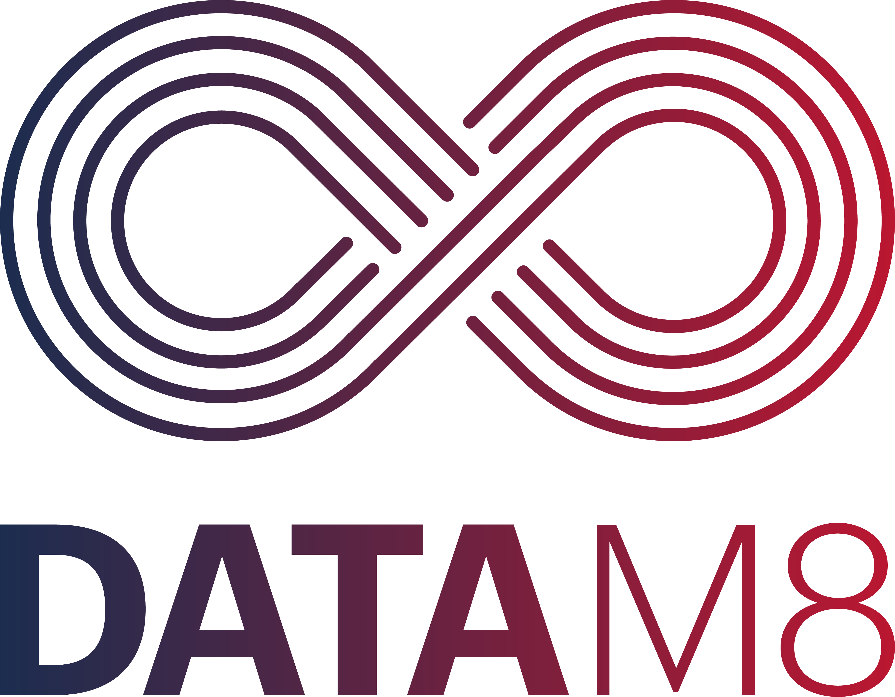
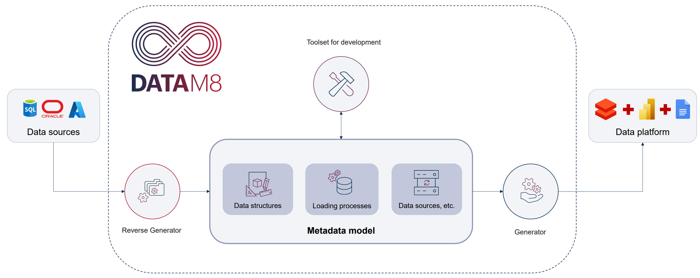
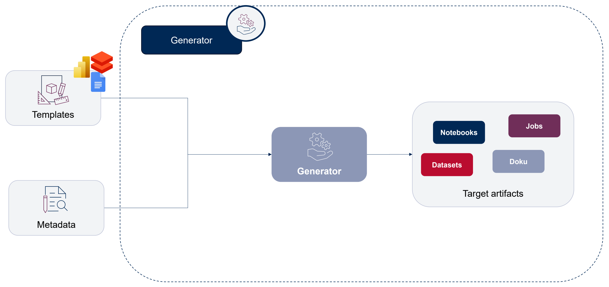

# DataM8 — Metadata-driven automation for your data platform

DataM8 helps teams build and evolve data platforms through metadata-driven code
generation. Describe your data structures and transformations once, then combine
them with reusable templates to generate consistent target artifacts.

Developed by ORAYLIS, DataM8 brings together a visual editor, an extensible metadata
model and a command-line generator — helping teams spend less time on repetitive
implementation and more time delivering business value.

## Why DataM8?

- **Faster development:** generate repetitive code from metadata and focus on
  business logic.
- **Reusable standards:** capture your team's conventions in templates and share
  them across projects.
- **Consistent results:** validate models and generate artifacts through a common
  process.
- **Central maintenance:** evolve shared templates and regenerate the affected
  artifacts.
- **Documentation from metadata:** keep generated model documentation aligned with
  the same metadata that drives your code.

## How DataM8 works

[Open the overview at full resolution](docs/assets/images/datam8-automation-overview.png)
to read the diagram labels on smaller screens.

DataM8 puts metadata at the center of automation. Describe data sources,
structures and transformations in a model, maintain it with the editor or your
development tools, and combine it with target-specific templates to generate
artifacts for your data platform.

The illustration shows the conceptual ORAYLIS Automation workflow. Source metadata
import depends on the available connectors; supported platforms and target behavior
are described in the [component references](docs/repositories.md#extension-paths)
and [sample documentation](docs/generator/README.md).

## Components and repositories

| Component | What it does | Repository |
| --- | --- | --- |
| Frontend | Visually edit models and manage solutions in the web editor or desktop application. | [datam8-frontend](https://github.com/oraylis/datam8-frontend) |
| CLI / Generator | Validate models and generate target artifacts from templates; provide the editor's backend. | [datam8-cli](https://github.com/oraylis/datam8-cli) |
| Metadata Model | Define the shared model structure and JSON schemas used by the editor and generator. | [datam8-model](https://github.com/oraylis/datam8-model) |
| Sample Solution | Explore a concrete model with templates, properties and example targets. | [datam8-sample-solution](https://github.com/oraylis/datam8-sample-solution) |

This repository is the central home for the product overview and user handbook.
See [repository responsibilities](docs/repositories.md) for technical references
and contribution routes.

## From metadata to artifacts

[Open the generator diagram at full resolution](docs/assets/images/datam8-generation-principle.png)
to inspect the artifact types.

Templates turn a shared metadata model into artifacts suited to your target
technology. You can adapt the templates to your architecture and conventions,
then inspect and version the generated output using your usual development tools.

The diagram illustrates possible artifact types; the original label "Doku" means
documentation. The [sample target reference](docs/generator/README.md) describes
the targets actually included in the sample. Generation writes files; deployment
and execution are subsequent steps in your platform's workflow.

Both diagrams are taken from the ORAYLIS Automation pitch. See
[illustration sources](docs/assets/images/README.md) for provenance.

## Get started

| Your goal | Start here |
| --- | --- |
| Use DataM8 | [Install](docs/installation.md), then follow the [illustrated user guide](docs/user-guide/README.md) |
| Develop automations | [Concepts](docs/concepts.md), [sample and template development](docs/generator/README.md), then [CLI usage](docs/validator.md) |
| Develop DataM8 | [Repository responsibilities](docs/repositories.md) and [contribution workflow](docs/contribution.md) |

Use the [documentation index](docs/index.md) for all topics. This documentation
covers DataM8 v2, currently in beta. Before combining components, consult
[compatibility and verification evidence](docs/compatibility.md).

[Issues](https://github.com/oraylis/datam8/issues) are tracked here. Include the
component and exact versions using the issue form. For sensitive reports, use
[the security reporting route](SECURITY.md).
