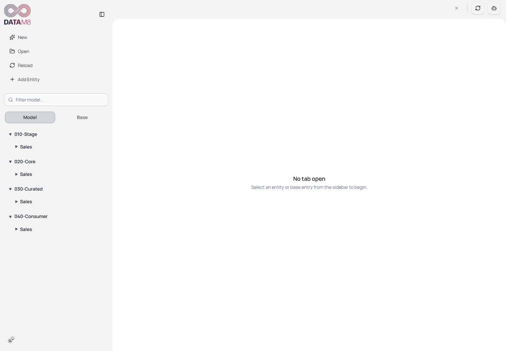

# DataM8 User Guide

Learn DataM8 by working with the ORAYLIS sample solution. You will open a complete
copy, understand its metadata, edit Customer, check persistence and generate model
documentation. No Azure account or database connection is needed for this path.

*The Model navigation shows Stage, Core, Curated and Consumer. Select an entity or
switch to Base to begin; the upper-right actions open refresh and generation.*

## Learning path

| Read | You will be able to |
| --- | --- |
| [1. Get started](getting-started.md) | Obtain the pinned sample, open a copy and understand mode differences |
| [2. Understand the solution](solution-and-base.md) | Explain Base, Model, Plugins, Generate, Output and all eight Base categories |
| [3. Explore and edit Customer](modeling.md) | Follow the layers, edit attributes, sources, relationships and transformations |
| [4. Save and reorganize](editing.md) | Verify autosave, recover from errors and use entity/folder actions |
| [5. Sources and connectors](sources.md) | Configure a source and understand optional import/refresh prerequisites |
| [6. Generate and inspect](generation.md) | Generate docs, inspect output and choose another target |
| [7. Go further](advanced.md) | Find template, payload and deployment references |
| [8. Troubleshooting and glossary](troubleshooting.md) | Diagnose common problems and look up terms |

Follow chapters 1–4 and 6 first. Chapter 5 is an optional connected-data workflow.
Screenshots use the real editor with neutral connection values. English UI labels
are preserved; sample attribute names such as `KundenID` are not translated.

## Version and evidence

This guide uses sample commit
`1e1855e59e2734b3a393f9128193504626ab9380` and the exact backend/schema combination recorded below. This four-target sample
is distinct from the three-target sample main baseline; see [compatibility](../compatibility.md).
The exact frontend/backend/schema revisions, screenshot settings and verified
operations are recorded in the [capture manifest](assets/manifest.json).
Use a pinned compatible set, not the moving `main` branches.

The browser capture verifies real loading, save/reload and `docs` generation.
Screenshots of configuration or a dialog do **not** prove live SQL connectivity,
native Electron behavior or generation of every target. See the
[acceptance report](acceptance.md) for coverage and limitations.

For contributors: [documentation index](../index.md),
[capture and maintenance](https://github.com/oraylis/datam8-frontend/blob/feature/external_refresh/docs/user-guide/capture.md), [review findings](https://github.com/oraylis/datam8-frontend/blob/feature/external_refresh/docs/documentation-review.md).
