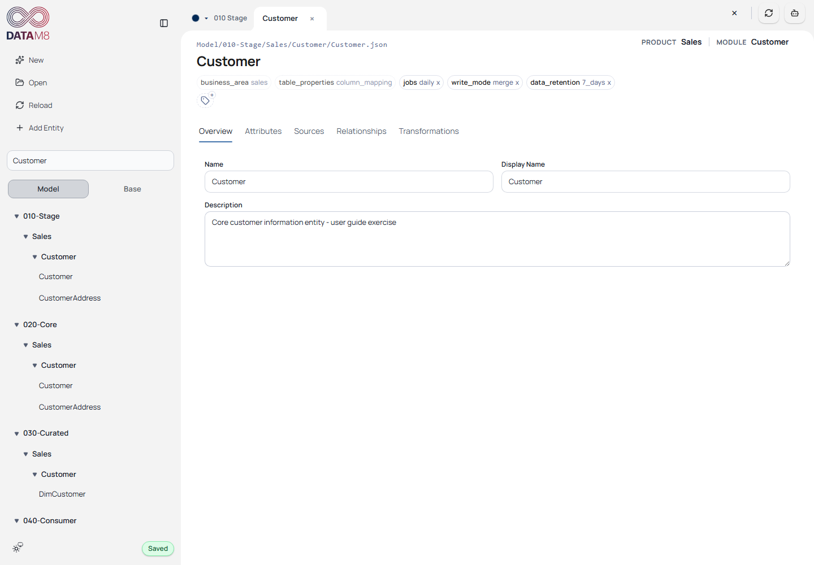
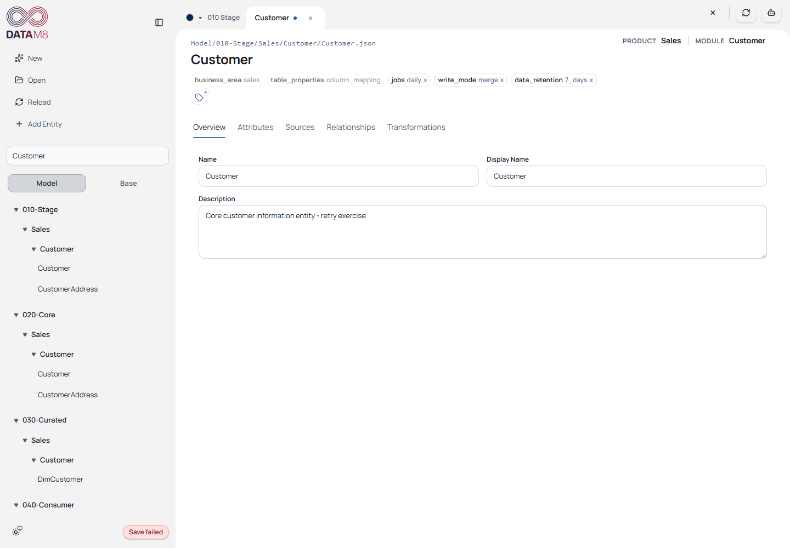
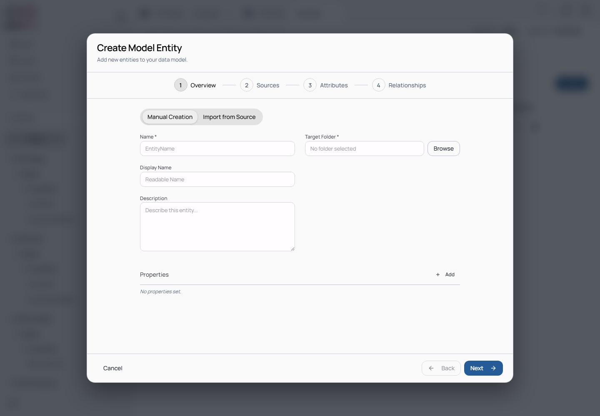
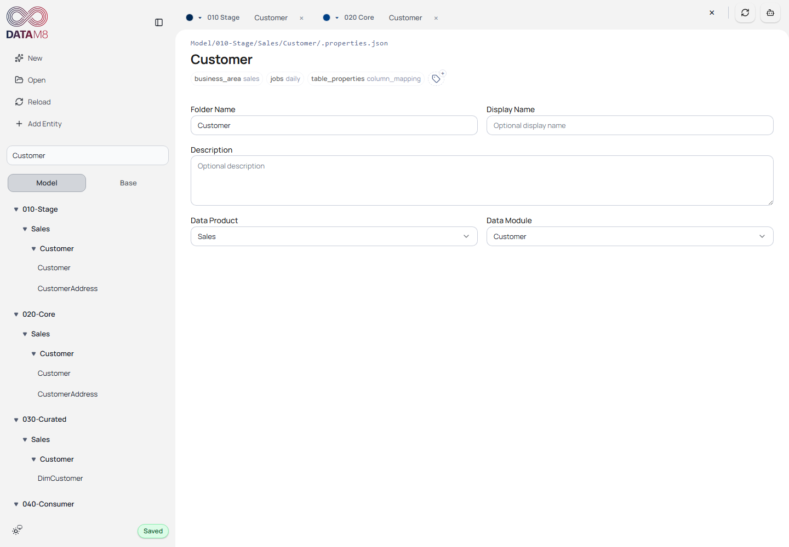

# 4. Save, Recover and Reorganize

[Guide index](README.md) · [Next: Sources](sources.md) · [Generate](generation.md)

## Verify a real save

DataM8 autosaves committed edits. Text edits save when focus leaves the field;
selection changes and add/remove actions schedule saves. Tab/selection switches
attempt persistence. Some incomplete Base drafts wait until required fields are
filled. A dirty marker can indicate pending synchronization or an unresolved failure.

1. Open Stage Customer → **Overview**.
2. Append ` - user guide exercise` to **Description**.
3. Click **Overview** to blur the description and wait for the save to complete.
4. Inspect `Model/010-Stage/Sales/Customer/Customer.json` in your working copy.
5. Click **Reload** and confirm the edited description is still visible.
6. Restore the original description and repeat the file check.

*The capture runner checks the saved JSON on disk and the reloaded UI, rather than
accepting a notification alone as proof of persistence.*

Generation is not a substitute for saving. Do not assume closing a tab or the app
will resolve a failed save. There is no manual Save All button in this captured UI.
See the [autosave reference](https://github.com/oraylis/datam8-frontend/blob/feature/external_refresh/docs/autosave.md) for contributor-level trigger details.

## Recover from a failure

Editor saves currently show a brief **Save failed** status in the sidebar and leave
the tab dirty. There is no explicit editor Retry button or persistent detailed error
panel in this captured version. Restore backend availability, then select another
entity/tab to trigger a new persistence attempt. Check the saved file and reopen the
entity. Other scoped operation errors may offer Retry, but do not assume it exists
for editor saves. Use backend logs to diagnose validation details.

If a close operation reports **Pending Sync**, keep the tab open while recovering.
Reload can discard unsynchronized drafts after confirmation. Restore a known-good
working copy if you intentionally want to abandon an exercise.

*The screenshot intentionally disables browser networking for one save. Networking
is then restored and a context-switch persist attempt is verified against real JSON; no successful
backend response is fabricated.*

## Create an entity

Choose **Add Entity**. The wizard offers metadata, sources, attributes and
relationships. Use a fresh exercise name such as `CustomerGuideDemo` in a chosen
existing folder; complete required fields and inspect every step before submission.

*This is the real wizard's initial state. The documentation capture cancels it;
it does not claim that this image verifies every creation/import path.*

**Check after creating:** the dialog closes, the new entity appears in the chosen
folder, a corresponding JSON file exists and Reload preserves it. If submission
fails, use the message rather than repeatedly adding duplicate drafts.

## Rename, duplicate, move and delete

Use the Model tree's entity context menu for supported actions. Duplicate first
to try structural edits. Choose a distinct name, inspect the target folder when
moving, and reload to verify the persisted path and references.

| Operation | Check afterward |
| --- | --- |
| Rename | New name/file path; dependent references remain resolvable |
| Duplicate | Independent entity and ID; referenced sources are still deliberate |
| Move | Entity appears in target folder; inherited properties may change |
| Delete | Entity/file absent after save/reload; review dependency warnings |

Delete only temporary tutorial objects. Folder deletion covers descendants; zone
changes and property refactors can trigger follow-up operations across the model.
Those are not equivalent to removing a harmless label.

## Folder metadata

Select a model folder to inspect its description, property assignments and effective
Data Product/Data Module. Persisted folder metadata lives in `.properties.json`.
Changing shared settings changes the context inherited by descendants.

*Select the folder rather than the similarly named entity. Its settings provide
shared context to children.*

For a small exercise, change a description on a copied folder, leave the field,
check `.properties.json`, reload and restore it. Treat property/value rename, move
and deletion as refactors: inspect follow-up results and generate again before
considering the model consistent.
