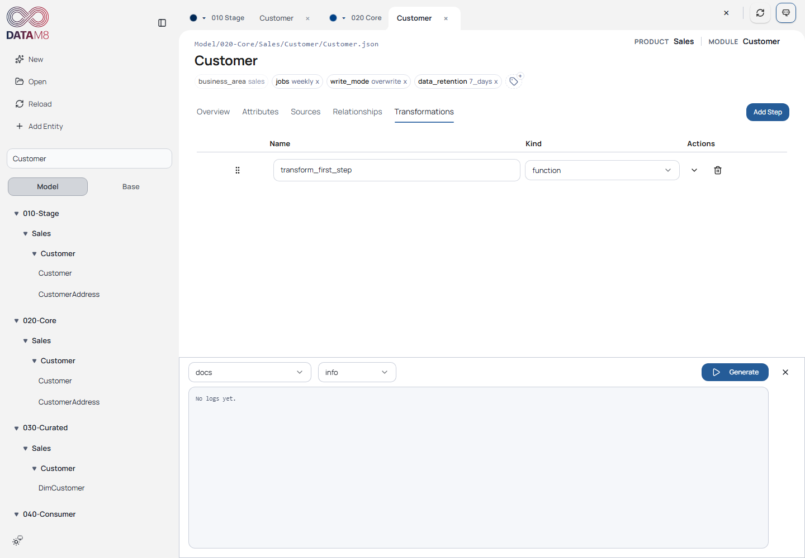
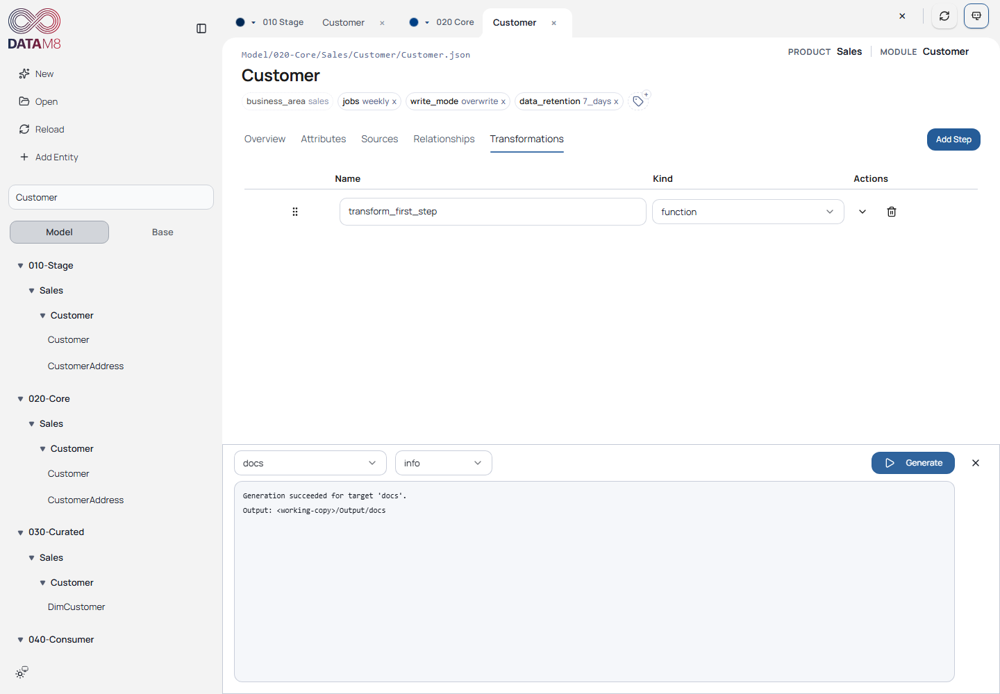

# 6. Generate and Inspect Output

[Guide index](README.md) · [Next: Go further](advanced.md)

## Generate documentation first

**Goal:** turn the edited metadata into inspectable local output without deploying
services or connecting to the SQL source.

1. Finish the save/reload check for your edits.
2. Open the generator using **Toggle generator** in the upper-right toolbar.
3. In the target dropdown choose **docs**; leave log level at **info**.
4. Choose **Generate** and wait for completion.
5. Confirm the success message and output directory.

*The target dropdown is distinct from log level. Run one target at a time.*

*The output path is masked as `<working-copy>/Output/docs` for publication; the
capture's backend response and generated files are real.*

**Check on disk:** open `Output/docs/index.md`, then an entity page below `entities/`.
Find Customer and inspect its attributes, properties, sources and relationships.
The draw.io file `diagrams/entity-relationships.drawio` visualizes relationships.
Generated filenames/content come from the pinned target implementation.

The capture verifies that the real UI request succeeds and that the generated
index exists and contains Customer. It does not merely load pre-existing checked-in
output. A repeated run regenerates the selected target; the UI requests clean output,
so keep hand-written work outside generated directories.

## Choose another target

The tutorial snapshot configures **four** targets. The sample main baseline
configures three with different Databricks/Power BI paths. These are different
revisions, not interchangeable output conventions; see [compatibility](../compatibility.md).
For this pinned tutorial:

| Target | Template source | Output | Purpose |
| --- | --- | --- | --- |
| databricks | `Generate/databricks` | `Output/databricks` | Notebooks and bundle resources |
| databricks-lakeflow | `Generate/databricks-lakeflow` | `Output/databricks-lakeflow` | Separate configured Databricks target; inspect its implementation before relying on differences |
| powerbi | `Generate/powerbi-tabular` | `Output/powerbi-tabular` | Tabular TMDL files |
| docs | `Generate/docs` | `Output/docs` | Model documentation and diagrams |

Choose a target and inspect its generated files before deploying anything. Zone
target properties influence inclusion; the consumer zone uses `powerbi`, while
stage/core/curated use `databricks`. Target names and zone property values need
not be interchangeable.

Only `docs` generation is verified by this guide's capture. Other targets may need
additional solution/bundle configuration. The Lakeflow README/architecture currently
duplicate Databricks wording and do not establish distinct feature semantics.

## When generation fails

Read the returned message and backend log. Typical causes include incompatible
schema/runtime, unresolved references, missing target files, invalid payloads or
target configuration. A failure from a template/payload is not necessarily a UI
problem. Correct the cause, save/reload as needed and generate again.

Generation runs synchronously; closing its panel is not proof of backend cancellation.
Avoid parallel requests and wait for completion. See
[troubleshooting](troubleshooting.md) and [advanced references](advanced.md).
