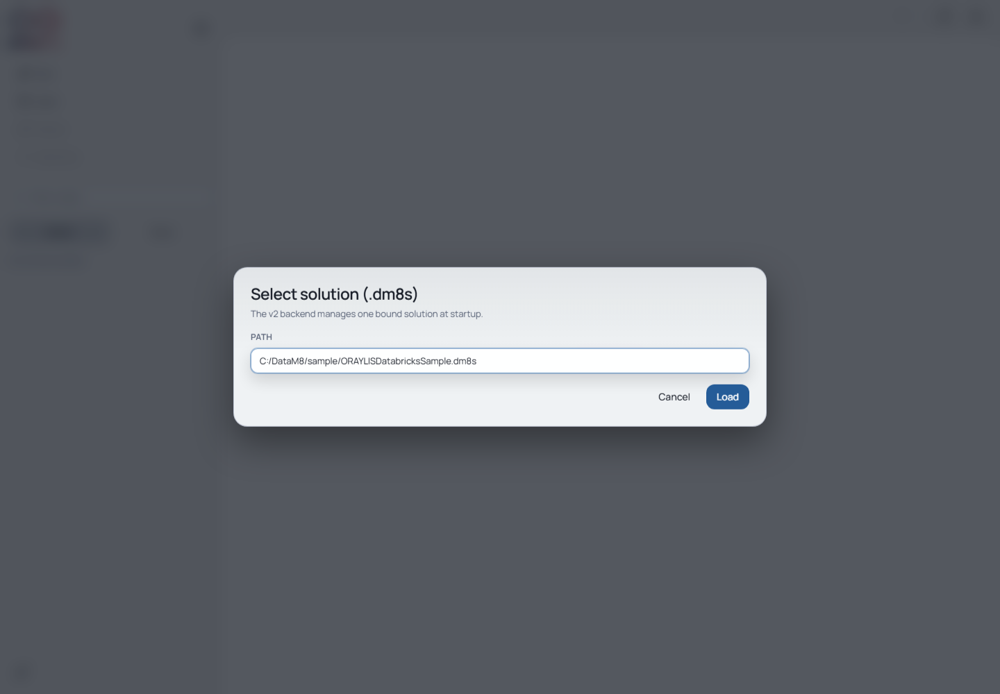

# 1. Get Started

[Guide index](README.md) · [Next: Solution and Base](solution-and-base.md)

## Obtain a complete working copy

**Goal:** open the same metadata/template revision used by this guide.

Clone the separate sample repository and select the recorded revision:

```sh
git clone https://github.com/oraylis/datam8-sample-solution.git datam8-sample
cd datam8-sample
git checkout --detach 1e1855e59e2734b3a393f9128193504626ab9380
```

Copy that directory to a new exercise directory using your file manager. Copy
**all** solution files, not only `ORAYLISDatabricksSample.dm8s`; Base, Model, Plugins,
Generate and supporting configuration are needed. Keep the original clone intact.
Autosave writes immediately and generation can clean a target output directory.

The sample's SQL source points at an example cloud host. You do not need to test
that connection for this tutorial. Before using screenshots or connection tests,
replace its host/username in your copy with your own neutral/local settings.
Do not add a password to a committed JSON file.

## Open in desktop

An installed desktop/sample combination still needs the separate packaged
acceptance described in [compatibility](../compatibility.md). For the already verified
browser path, use the exact capture revisions listed there. For desktop acceptance,
select the intended installed version and a disposable sample copy. If developing locally, follow the [frontend setup](https://github.com/oraylis/datam8-frontend/blob/feature/external_refresh/README.md#local-development).
Node and uv are development prerequisites; an installed desktop package bundles
its backend runtime.

1. Choose **Open** in the left navigation.
2. Use **Open Solution...** and select the working copy's `.dm8s` in the native dialog.
3. Wait for the Model tree to appear.
4. Confirm the four layer folders: `010-Stage`, `020-Core`, `030-Curated`, `040-Consumer`.

**Check:** selecting Model → Customer later should show a path below your working copy,
not the original clone. Native dialogs are desktop-specific; the illustrations
below show the browser alternative, not a photographed native picker.

## Open in a browser

For local development, start Generator with `--solution` pointing to the copied
`.dm8s`, then start Vite with `VITE_API_URL` matching its port. Exact Windows and
POSIX commands are in the [frontend README](https://github.com/oraylis/datam8-frontend/blob/feature/external_refresh/README.md#local-development).

1. Open the Vite URL, normally `http://localhost:4320`.
2. In **Select solution (.dm8s)**, enter the copied path and choose **Load**.
3. Confirm the four model layers.



*The browser backend manages one solution bound at startup. The displayed path is
illustrative: entering another path does not switch server workspaces. Restart
the backend with the intended `--solution` to change the loaded solution.*

## Mode and compatibility limits

| Feature | Desktop | Browser with a bound backend |
| --- | --- | --- |
| Open a complete solution | Native picker and preload | Reads server's startup-bound solution |
| Edit existing metadata | Supported | Supported |
| Initial function file create/delete | Constrained desktop bridge | Unavailable |
| Generate | Preload delegates to CLI | Synchronous backend request |
| Data preview | Depends on connector capability | Depends on connector capability |

The tutorial does not rely on **New Project**, migration or uploading a lone
`.dm8s`. Historical parity endpoints do not establish these flows as supported
by the pinned backend. See [backend constraints](https://github.com/oraylis/datam8-frontend/blob/feature/external_refresh/docs/backend-contract.md).
