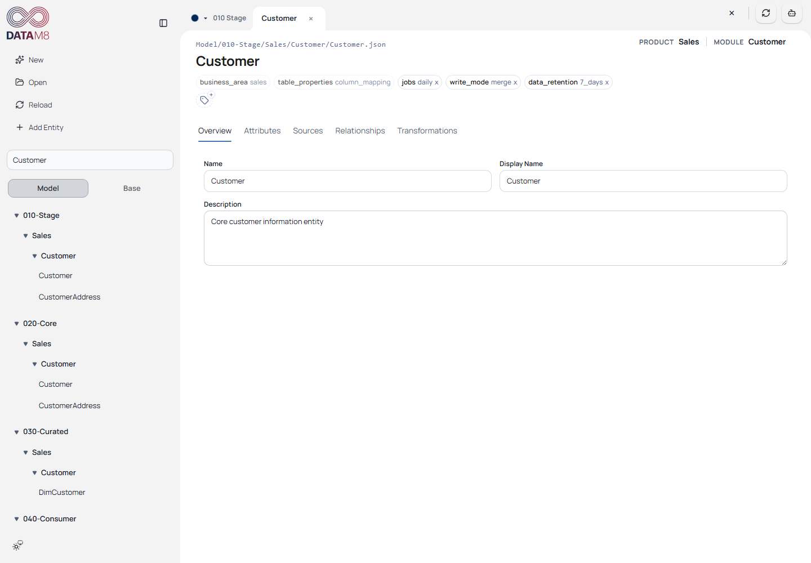
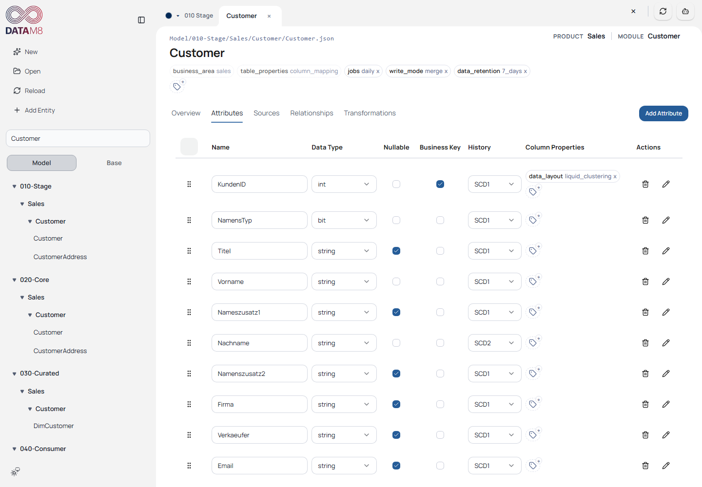
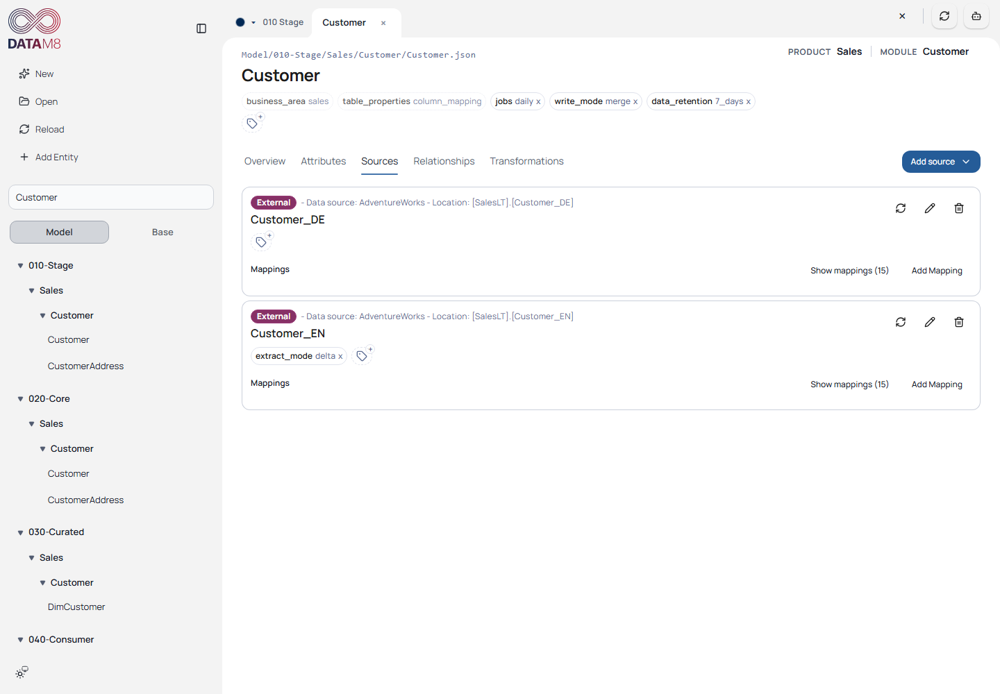
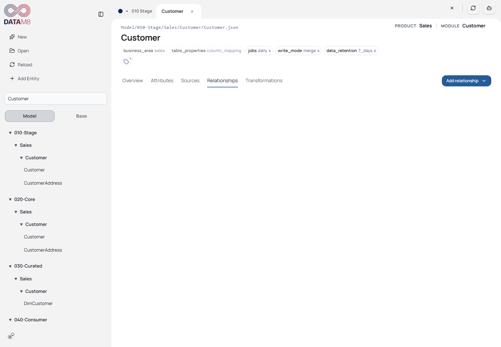
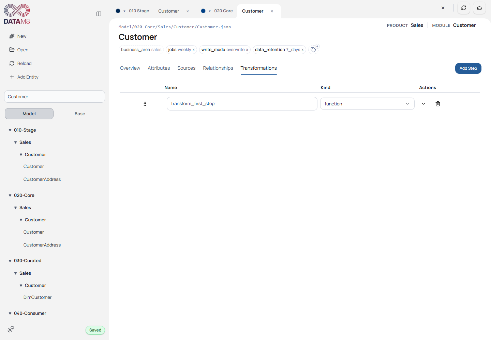

# 3. Explore and Edit Customer

[Guide index](README.md) · [Next: Save and reorganize](editing.md)

## Follow Customer through the model

Choose **Model**, type `Customer` in the filter and select the first **Customer**
below `010-Stage/Sales/Customer`. The path above the editor disambiguates entities
with the same name. Repeat for Core Customer, Curated DimCustomer and Consumer
Customer to understand how source-facing data becomes an analytical model.

*Use the full path, not just Customer's label, to identify the entity. The header
also shows inherited properties and effective product/module context.*

## Overview

**Name** identifies the entity; **Display Name** is the readable label;
**Description** explains purpose. Start with a description edit rather than a
rename, because renames have reference and file-path consequences.

**Exercise:** append ` - user guide exercise` to the Stage Customer description,
then click **Overview** to leave the field. Continue with the persistence check in
[Save and reorganize](editing.md). Restore the original description afterward.

## Attributes

Choose **Attributes**. Inspect `KundenID`, its integer type, nullability and business
key flag. Inspect `Nachname` to see an example of history metadata. Physical data
type, semantic attribute type, business key and history answer different questions.

*A business key identifies a source/business record; a surrogate key is a generated
technical identifier. The selected target determines how those flags are rendered.*

Expand an attribute to inspect details and properties. Use the selection checkboxes
and bulk edit for deliberate common changes; verify the selected count before
applying. Keep required fields complete. A change to a type or expression may
affect generated SQL even if the UI accepts the metadata.

## Sources and mappings

Choose **Sources**. An external source points to a configured Data Source and
location; an internal source points to another model entity. Mappings connect
source columns/attributes to target attributes. Aliases distinguish multiple sources.

*Opening saved source metadata does not require a live source connection. Browsing
locations or fetching metadata does.*

**Exercise:** inspect Stage Customer's external mapping, then inspect Core
Customer's internal source. **Check:** the referenced source and mapped target
attribute must exist. `sourceLocation` is the read location; `metadataLocation`,
when present, is the handle used by the connector for later metadata refresh.

## Relationships

Choose **Relationships**. A relationship defines a target and one or more
source/target attribute pairs. It differs from a source mapping: relationships
express links between modeled objects rather than how an entity reads its inputs.

*Inspect the saved relationships before adding one. A dialog accepts complete
linkage/mappings; an empty relationship is not a valid committed definition.*

When adding a relationship, choose its internal model target or external data
source/location, complete the attribute pairs and save the dialog. Review the
target and reload before using it in generation. Backend validation remains authoritative.

## Transformations

Select **Core Customer** and choose **Transformations**. Transformation steps
describe the ordered processing for that entity; existing function steps reference
Python files stored beside the model entity. Expand the source control to inspect
code when it is available.

*Transformation metadata and function source files are separate artifacts. Reordering
steps changes execution intent; function creation/deletion needs the desktop bridge.*

For a first exercise, inspect rather than alter business logic. If you edit source,
wait for persistence and compare both the entity JSON and Python file. Saved code
is not proof that a transformation has run successfully in Databricks.
