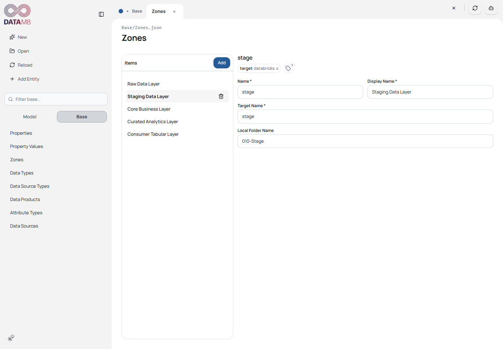
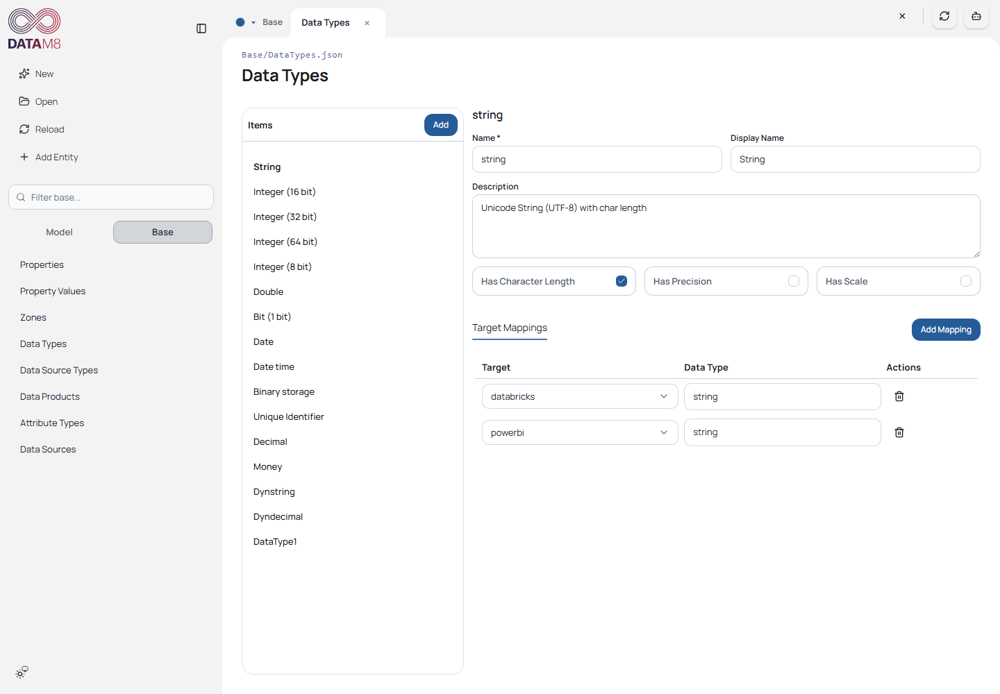
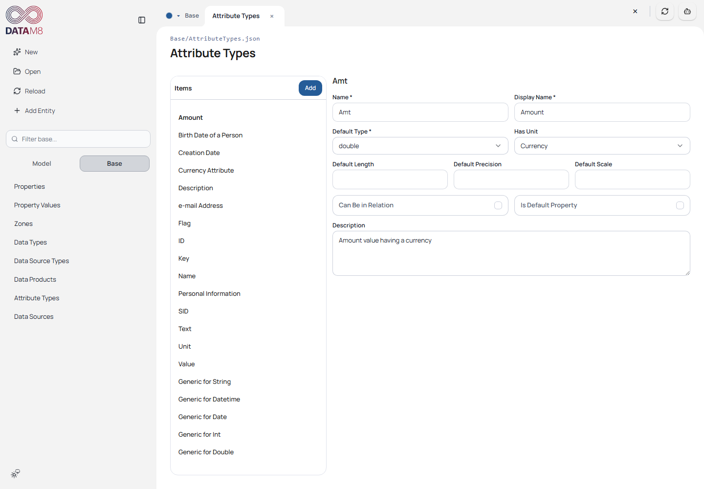
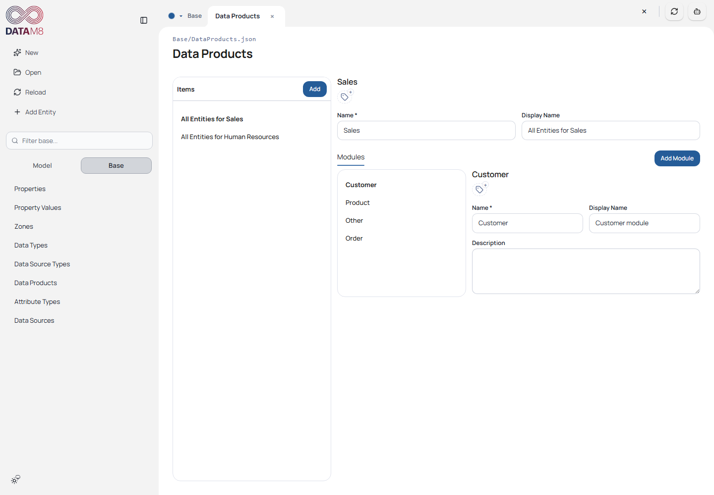
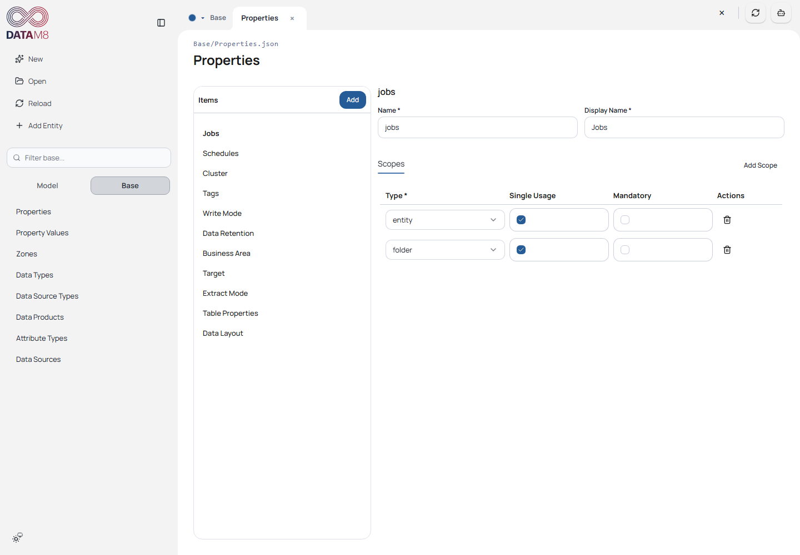
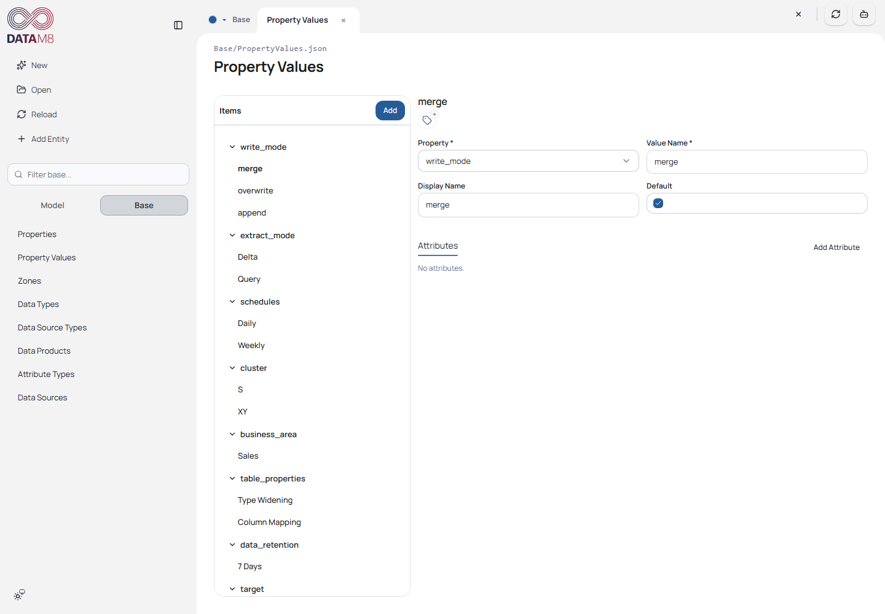

# 2. Understand the Solution and Base

[Guide index](README.md) · [Next: Modeling](modeling.md)

## From metadata to output

The `.dm8s` selects paths and generator targets. Base provides shared definitions;
Model uses them to describe entities. The selected target's Python payload code
interprets that model and Jinja templates render output files.

```text
ORAYLISDatabricksSample.dm8s
  Base/       shared definitions
  Model/      entity JSON, folder metadata and Python transformations
  Plugins/    connector manifests and implementations
  Generate/   Python payload builders and Jinja templates
  Output/     generated artifacts, one directory per target
```

Generation prepares files. It does not deploy a database, run Databricks jobs or
publish a Power BI model. Those are separate deployment/runtime operations.

## The sample layers

| Zone | Folder | Role |
| --- | --- | --- |
| stage | `010-Stage` | Source-facing entities and mappings |
| core | `020-Core` | Integrated business entities |
| curated | `030-Curated` | Dimensions and facts for analytics |
| consumer | `040-Consumer` | Consumer/tabular model |

The sample also defines a `raw` zone without an equivalent populated root folder.
Zone name, target name and local folder name are distinct fields. For example,
stage's local folder is `010-Stage`; do not substitute a display label in a locator.

## Explore all Base categories

Choose **Base**, then a category. The middle list selects an item; the editor on
the right shows its definition. All categories share the same autosave principles.

| Category | What it controls | Sample exercise |
| --- | --- | --- |
| Zones | Layer names, local folders and target properties | Select Staging Data Layer and inspect `010-Stage` |
| Data Types | Common data-type definitions | Inspect a text/integer definition |
| Attribute Types | Semantic column roles | Inspect the role used by a business-key attribute |
| Data Source Types | Connector binding and source type mappings | Inspect SQLServer and its plugin ID |
| Data Sources | Concrete connection configuration | Inspect AdventureWorks without testing its cloud host |
| Data Products | Business organization and modules | Inspect Sales |
| Properties | Named metadata settings and allowed scopes | Find `write_mode` |
| Property Values | Reusable values and associated metadata | Inspect `merge`, `overwrite` and `append` |



*The zone binds local organization to generation metadata. Renaming or deleting
zones can affect model folders; use a disposable copy for these operations.*



*Data Types describe reusable physical type settings.*



*Attribute Types add semantic meaning beyond a physical data type.*



*Data products organize modeled data; effective product/module context may inherit
from folders.*

## Properties and inheritance

Open **Properties** to inspect a definition, then **Property Values** to inspect
its values. A definition's allowed scope matters: entity, folder, attribute,
source and mapping properties are not interchangeable.



*Definitions establish how a named setting can be assigned.*



*Property values may themselves contain metadata, such as job schedule or cluster settings.*

Folder properties inherit down the folder chain; a nearer assignment overrides
the same property. An entity can override an inherited property with its own
assignment. The editor distinguishes inherited chips from directly removable
entity chips. Effective Data Product/Data Module context is also shown.

**Exercise:** open Stage Customer and compare inherited `business_area=sales`
with its directly assigned `write_mode=merge`. Inspect the folder before changing
the inherited value. **Check:** the chip tooltip identifies inherited metadata;
changing a shared folder can affect several children.

Custom properties acquire behavior through a generator target. They are not
universal engine options. See [advanced references](advanced.md) for target-specific rules.
