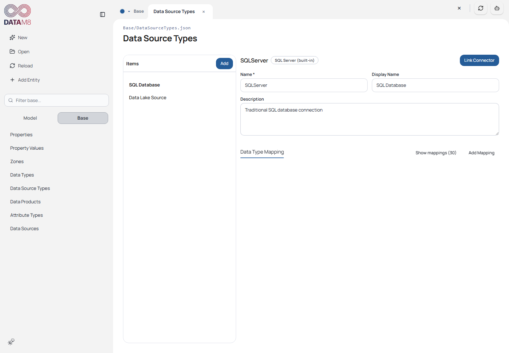
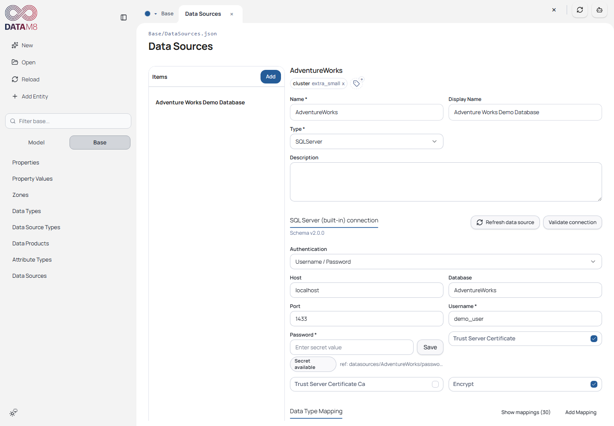
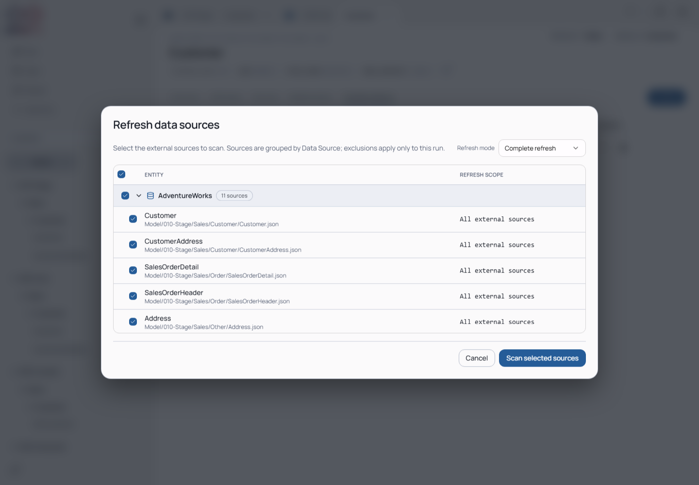

# 5. Sources and Connectors

[Guide index](README.md) · [Next: Generation](generation.md)

This chapter is optional. Saved metadata can be inspected offline. SQL/cloud
operations need source access, dependencies and credentials; local ODCS navigation,
validation and import work offline with accessible files.

The screenshots describe the recorded tutorial combination in [compatibility](../compatibility.md).
The published capture did not run a live SQL import/refresh; Docker was unavailable.
The builtin and type-mapping instructions below describe the current development
frontend/backend, not an additional beta.6 or screenshot acceptance result.

## Inspect the binding

Choose **Base → Data Source Types**, then SQLServer. Inspect the linked connector,
its connection definitions and physical-to-model type mappings.

*The Data Source Type defines reusable connection fields and type conversion.
Its plugin ID must match a discovered manifest.*

Choose **Data Sources**, then AdventureWorks. Concrete host/database/authentication
settings belong here. The password is a `ref://` secret reference, not a plaintext
password in the solution JSON.

*Host and username were replaced in the temporary sample copy before capture.
These values do not represent a running database or working credentials.*

## Configure type mappings

Linking a plugin copies its suggested mappings into the Data Source Type. Review
and save them. If the plugin supplies no suggestions, configure the necessary
mappings manually. Runtime imports use this saved configuration; changing plugin
suggestions alone does not update existing mappings.

For example, `BIGINT → long` makes the model attribute a `long` while preserving
`BIGINT` in its source mapping. A concrete Data Source can override the conversion.
The current development matcher checks:

1. Data Source mappings: complete source type, then its base type.
2. Data Source Type mappings: complete source type, then its base type.

Matching ignores case and surrounding whitespace. `DECIMAL(18,2)` can match
`DECIMAL`; `STRUCT<...>` can match `STRUCT`. Duplicate normalized keys within
one level are errors. Missing mappings are errors even when the source type looks
like a model type; there is no automatic replacement with `string`.

A plugin may return `nvarchar` and length 62 separately, or retain
`nvarchar(62)` and also supply its length. The backend preserves what the plugin
returns rather than stripping parameters itself.

Ensure the mapped model types exist under **Base → Data Types**. Backend import
and complete refresh require exactly one **Attribute Type** for each mapped type
with matching `defaultType` and `isDefaultProperty=true`. A missing or duplicate
default causes an error; neither definitions nor defaults are created automatically.
The backend's translation does not currently add a separate Data Types existence
check, so a successful mapping is not proof that the solution defines the type.

When the frontend receives a complete backend import description, it retains its
Attribute Types. For the alternative metadata-only import, it uses the same saved
type mappings and assigns `Regular`; ensure that Attribute Type is defined.
See [the technical contract](https://github.com/oraylis/datam8-cli/blob/feature/external_refresh/docs/backend-contract.md#source-import-and-refresh)
for precise ownership and matching semantics.

## Use the ODCS builtin

In the current development version, bind a Data Source Type to
`builtin:OdcsFile`; external plugin files are unnecessary. Review its mappings and
prepare the Data Types/default Attribute Types described above.

Create a Data Source using that type. Set `path` to a contract file or directory
and `protocol` to `file`. Relative paths start at the solution folder.
The builtin uses `no_auth` and needs no cloud credentials.

In **Add Entity → Import from Source → External**, choose the configured source
and load its listed objects. For a directory connection, open folders and contract
files, then select a schema object. A single-file connection exposes schema objects
directly. Select the returned object rather than entering a source location manually.

Contracts must use ODCS `v3.2.0`. The backend validates against its bundled schema
offline. Each schema object is imported separately; access outside the configured
root is rejected. Preview is unavailable because a contract describes metadata,
not its underlying rows.

ODCS preserves physical source types, or uses the declared logical type when no
physical type is given. Unknown physical types need explicit mappings.
Business names become display names, while the chosen target name remains technical.
Nested properties stay one attribute; quality/governance sections are not imported.
See [builtin configuration and limits](https://github.com/oraylis/datam8-cli/blob/feature/external_refresh/docs/builtin-sources.md#local-odcs-contracts)
for details.

## Use the Unity Catalog builtin

Bind a Data Source Type to `builtin:DatabricksUnityCatalog` and review its saved
mappings. Create a Data Source with a workspace URL and one of the supplied auth
modes: PAT, Databricks OAuth Client Credentials or Azure Entra Service Principal.
Save tokens/client secrets through the secret workflow and use `ref://` references.

Optional catalog and schema filters narrow navigation. Load and select the listed
catalog/schema/table objects. The connector provides comments, column order,
nullability, type dimensions and available primary keys while retaining the
original source type.

Metadata does not need a SQL Warehouse. Preview additionally requires a warehouse
ID or its HTTP path and suitable permissions. Without that query configuration,
preview remains disabled. Preview accepts 1–1000 rows and has a shared 30-second
budget; it may time out independently of working metadata navigation.
See [configuration and preview limits](https://github.com/oraylis/datam8-cli/blob/feature/external_refresh/docs/builtin-sources.md#databricks-unity-catalog).

## Prepare a local SQL source

For a reproducible connected exercise, use the backend's
[local AdventureWorks SQL Server setup](https://github.com/oraylis/datam8-cli/blob/feature/external_refresh/tests/db/README.md).
Restore the sample database, configure a source in your copy for that container
and supply credentials through the supported secret UI/keyring setup. Install
the pinned backend's SQL extras and the required SQL Server driver for your OS.

Keep cloud-specific deployment/key-vault instructions separate from this local
exercise. See [advanced references](advanced.md) for the sample deployment documentation.

## Connection, import and preview

1. Configure the local AdventureWorks source and use its connection-test action.
2. Choose **Add Entity**, then the source-backed/import path offered by the wizard.
3. Select the configured source and load its locations.
4. Select a table, inspect metadata and preview if the connector supports it.
5. Choose a target folder and distinct entity name; review attributes/mappings.
6. Complete creation, inspect the new JSON and reload.

**Check:** a successful connection test is only the first step. Verify column names,
types, keys, descriptions and source mappings in the created entity. Save and Reload
to confirm persistence. Preview follows the configured connection's capabilities:
ODCS has no row preview, and Unity Catalog needs query configuration in addition
to metadata access. Disabled preview does not necessarily mean connection failure.

## Refresh existing source metadata

Choose **Refresh data sources** in the upper-right toolbar. Select source-backed
entities and the desired mode before scanning.

*This capture shows selection only. Scan/review/apply require working local source
access; no fabricated successful diff is included.*

- **Complete refresh:** translates source types through current saved mappings and
  compares source-owned attributes and source/mapping metadata, while preserving
  local fields according to the backend contract.
- **Sources-only:** refreshes external sources/mappings without replacing entity
  attributes, properties, transformations or relationships. It does not need
  target-type translation.

Review each proposed change before applying. Pay particular attention to removed
mappings and type changes. After application, inspect affected entity JSON and
Reload. Run generation to expose unresolved model dependencies.

See the [canonical source contract](https://github.com/oraylis/datam8-cli/blob/feature/external_refresh/docs/backend-contract.md#source-import-and-refresh)
for ownership/conflict details; do not assume all manually assigned source metadata
will survive an authoritative connector refresh.
